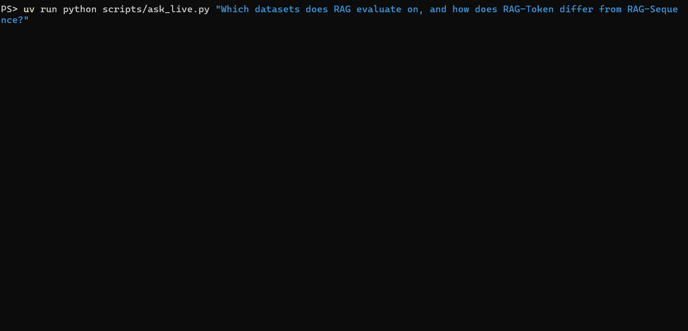
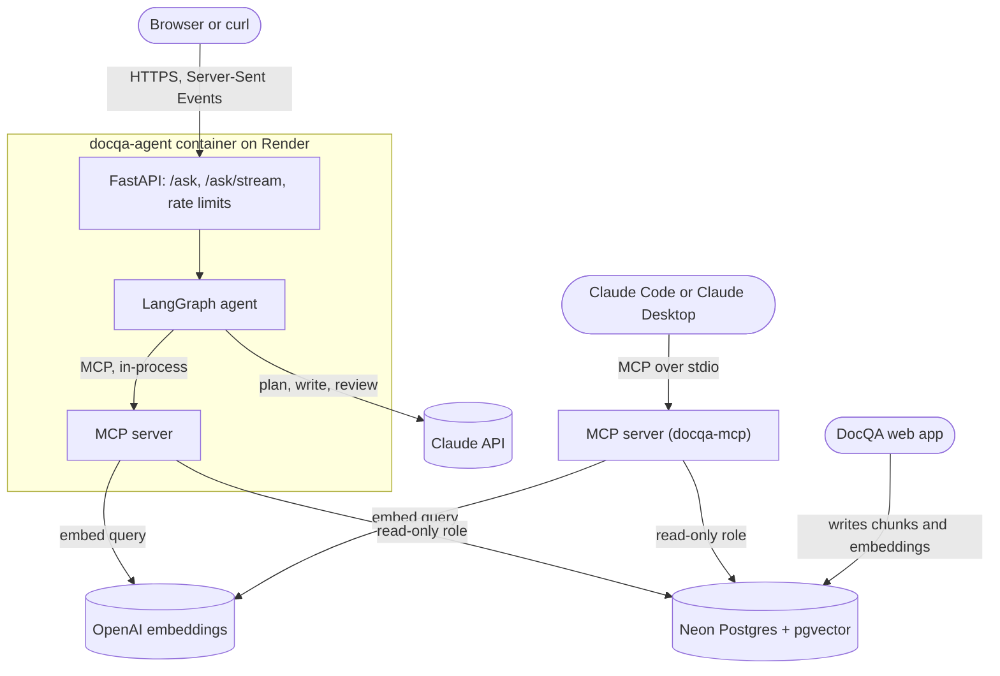

# docqa-agent

A read-only [MCP](https://modelcontextprotocol.io) server that lets any MCP client, such as Claude Code, Claude Desktop or your own agent, search the PDF documents indexed by [DocQA](https://github.com/JasrajCode/docqa).

It reads the same Postgres + pgvector tables that DocQA writes, so an AI assistant gets DocQA's semantic search as a set of tools it can call. On top of the server sits a LangGraph agent that answers questions and has every claim checked against its sources. The agent is available as a CLI (`docqa-ask`) and as a rate-limited HTTP API that streams its progress, packaged with Docker and deployed on Render.

**Live API:** https://docqa-agent.onrender.com (interactive docs; on Render's free tier the first request after 15 idle minutes takes about a minute while the service wakes)





## Tools

| Tool | What it does |
|---|---|
| `search_documents(query, k=5, document_id=None)` | Embeds the query and returns the `k` closest chunks by cosine similarity, best first |
| `get_chunk(chunk_id)` | Returns a single chunk, for example to quote it exactly |
| `list_documents()` | Lists the available documents with their status and chunk count |

All three are marked read-only, and results come back as structured JSON validated by pydantic models.

## Agent

`docqa-ask` answers a question with a LangGraph workflow that runs on top of the MCP server:


| Node | Role |
|---|---|
| `planner` | LLM. Splits the question into up to 4 search queries, or none if it can be searched as written |
| `retriever` | No LLM. Runs the queries through the server's `search_documents` tool in parallel and merges the passages |
| `writer` | LLM. Drafts an answer citing passages inline by `chunk_id`, and lists each claim with its sources |
| `reviewer` | Rejects citations of passages that were never retrieved without calling the LLM. Otherwise an LLM checks each claim against its passages, reasoning before each verdict, and can request follow-up searches. Approval is computed in code from the per-claim checks, so it can't contradict them |
| `finalize` | Resolves citations to document titles and records whether the reviewer approved |

The reviewer can send a draft back at most twice (`AGENT_MAX_REVISIONS`), so a run makes 3 to 7 LLM calls. When the limit is reached, the answer is returned with its unsupported claims listed.

```bash
uv run docqa-ask "Which datasets were used to evaluate RAG?"
uv run docqa-ask --json "Which datasets were used to evaluate RAG?"
```

All three LLM roles use one Claude model (`AGENT_MODEL`, Claude Haiku by default) with pydantic-validated structured outputs. The agent always reaches the server through mcp's own client: the CLI launches it over stdio, and the API runs it in the same process, so both paths exercise the real MCP protocol. `langchain-mcp-adapters` was the original plan, but it requires mcp below 2.0 and this server is built on mcp 2.

To trace runs, set `LANGSMITH_TRACING=true` and `LANGSMITH_API_KEY` in `.env`. Each run then appears in LangSmith with every node's inputs, outputs, latency and token usage.

## HTTP API

`docqa_agent.api` serves the agent over HTTP with FastAPI. Interactive docs are at `/docs`.

| Endpoint | What it does |
|---|---|
| `GET /health` | Liveness check for the platform; makes no external calls |
| `POST /ask` | Runs the agent and returns the answer, citations, searches and review outcome as JSON |
| `POST /ask/stream` | Same run, streamed as Server-Sent Events: a `progress` event as each node finishes, then a `result` event (or an `error` event) |

```bash
curl -N -X POST https://docqa-agent.onrender.com/ask/stream \
  -H "content-type: application/json" \
  -d '{"question": "What datasets does the RAG paper evaluate on?"}'
```

```
event: progress
data: {"step": "planner", "message": "Planned 1 search", "queries": ["What datasets does the RAG paper evaluate on?"]}

event: progress
data: {"step": "retriever", "message": "Retrieved 8 new passages", "queries": []}

event: progress
data: {"step": "writer", "message": "Drafted an answer", "queries": []}

event: progress
data: {"step": "reviewer", "message": "Reviewer approved the draft", "queries": []}

event: result
data: {"question": "...", "answer": "... [b06787ae-...]", "citations": [...], "approved": true, ...}
```

For readable output, [scripts/ask_live.py](scripts/ask_live.py) prints each step with its timing as it arrives, then the answer with numbered sources. It uses only the standard library, and `DOCQA_API_KEY` adds the `X-API-Key` header:

```bash
uv run python scripts/ask_live.py "How does RAG-Token differ from RAG-Sequence?"
```

To run it locally:

```bash
uv run uvicorn --factory docqa_agent.api:create_production_app --reload
```

**Streaming progress, not tokens.** An agent run takes 10 to 20 seconds, and most of that is spent in steps whose output is structured JSON rather than prose. Streaming LangGraph's per-node updates (`stream_mode="updates"`) shows what the agent is doing as it happens; streaming the writer's tokens would show text the reviewer might still reject.

**Every question costs money, so the API is rate limited.** Each client gets 5 questions per hour, and all clients together get 100 per day. The client is identified by the `X-Forwarded-For` entry that Render's proxy appended, counted from the right, because entries to its left are whatever the client sent and could be changed on every request. A request with a key from `API_KEYS` in the `X-API-Key` header skips the limits, and keys are compared in constant time. The counters live in memory, which is correct for one instance but resets whenever the free-tier service sleeps, so the hard ceiling on spend is the monthly limit set in the Anthropic console.

**Failures don't leak internals.** If the agent raises, the full traceback goes to the server log and the client gets a generic 502 (or an `error` event when streaming). The response also omits the raw retrieved passages, which can be large; citations carry the document title and chunk index instead.

## Evaluation

`docqa-eval` runs the 27 questions in [evals/dataset.json](evals/dataset.json) through the agent and through a single-pass RAG baseline (one search, one LLM call, no review, which is roughly what DocQA does). Each answer is graded against a reference answer by an LLM judge, and every run is saved to [evals/results](evals/results).

The questions cover facts, comparisons and numbers from the RAG paper, two multi-part questions that need two separate passages, five questions on the Transport 2050 documents (testing search across documents), and three questions the documents can't answer.

| Metric | Meaning |
|---|---|
| Retrieval hit rate | Share of answerable questions where a retrieved chunk contains the gold passage. Gold passages are short exact quotes, matched ignoring case and line breaks, so the dataset survives re-chunking |
| Citation hit rate | Same check, but only over the chunks the answer cites |
| Correctness | Judge score against the reference answer: correct 1, partially correct 0.5, incorrect 0 |
| Abstention accuracy | Share of unanswerable questions where the system says the documents don't cover it |
| Fabricated citations | Share of answers citing a chunk that was never retrieved |
| Review text leaked | Share of answers that talk about the review process ("the reviewer's flagged statement") instead of answering |

**Results** from a single run over 27 questions (`claude-haiku-5-5`, 8 chunks per search for both systems, run `20261125-025221`). Counts are shown next to rates because one question is worth about 4 points:

| Metric | Agent | Single pass |
|---|---|---|
| Retrieval hit rate | 79% (19 of 24) | 75% (18 of 24) |
| Correctness (0-1) | 0.89 | 0.91 |
| Fully correct | 85% (23 of 27) | 85% (23 of 27) |
| Abstention accuracy | 100% (3 of 3) | 100% (3 of 3) |
| Fabricated citations | 0% | 0% |
| Reviewer approval | 100% | n/a |
| Median latency | 9.2s | 3.4s |
| Mean LLM calls | 3.15 | 1.00 |
| Mean input tokens | 18,349 | 6,354 |

On accuracy the two systems are tied: they get the same 23 questions fully right, and the retrieval gap is a single question. The differences that are large enough to mean something are cost and latency.

**What the results say**

- On single-fact questions the two systems tie. The planner leaves those questions whole, so the agent runs the same search, and the review step almost never changes the outcome (100% approval, 0.07 revisions on average).
- The agent's advantage is multi-part questions. Splitting "how many GPUs, and how many documents in the index" into separate searches retrieved both facts; one search found only one.
- That advantage costs about 3x the input tokens and LLM calls and 2.7x the latency.
- The five questions both systems miss are retrieval failures: the right chunk isn't in the top 8 for either. The next improvement is retrieval quality, such as a reranker or hybrid keyword and vector search, rather than more agent steps.
- The reviewer is a weak gate. It approved every draft in both runs, including an unreadable answer to `rag-decoding` in the first run that contained inline self-corrections (`[8f9bcf13-…] no, correctly: [204f950c-…]`, `[19ad? no]`) and a paragraph addressed to the reviewer itself. Two gaps explain this: the deterministic citation check only validates chunk ids listed in `claims`, not ids written inline in the answer, and the LLM reviewer judges whether claims are supported, not whether the answer is complete or well formed. For the same reason, an honest "the passages don't say" passes review even when retrieval missed the answer.

**How the eval changed along the way.** The first full run (`20261125-024841`) favoured the baseline, but it gave the agent 4 chunks per search against the baseline's 8. Equalising that raised the agent's retrieval hit rate from 65% to 79%, and 8 is now the default. That run also had two answers fail schema validation, where the model put the claims list inside the answer text; switching from forced tool calling to Claude's native structured outputs fixed it. Earlier, the judge scored two nearly identical answers differently, which led to a clearer rubric for unanswerable questions. Reading that run's answers also showed that all three revised drafts addressed the reviewer ("On the reviewer's flagged statement...") instead of the user, because the rewrite request was phrased as a message from a reviewer. The writer is now told its answer goes straight to the user, the rewrite request is phrased as a plain instruction, and the leak is tracked as its own metric; six forced rewrites of those questions produced no leaks.

**Limitations.** 27 questions is a small set: one question moves a rate by about 4 points, so small gaps are ties. Each number comes from a single run, and current Claude models don't accept a temperature setting, so reruns vary. The judge is the same model as the systems it grades, which can bias it toward their answers. The reviewer's 100% approval rate reflects how lenient it is, not answer quality, so it shouldn't be read as a quality guarantee.

```bash
uv run docqa-eval --check-dataset         # every gold quote exists in the corpus
uv run docqa-eval                         # both systems, all questions
uv run docqa-eval --systems agent --cases rag-variants t2050-gondola-route
```

A full run takes about two minutes and makes roughly 200 LLM calls. Results are written as each case finishes, so an interrupted run keeps its completed cases.

## Design decisions

**Direct database access with a read-only role.** The server connects to DocQA's database as `docqa_agent_ro`, which can only `SELECT` from `Document` and `Chunk` ([sql/readonly_role.sql](sql/readonly_role.sql)). `Account` holds users' OAuth tokens, so the role can't see it. A test runs that exact SQL and confirms the role can't read `Account`, delete rows or create tables.

**Scope comes from config, never from tool arguments.** The model chooses tool arguments, so a prompt-injected document could otherwise ask for another user's data. The users this server may read are fixed in `DOCQA_SCOPE_USER_IDS`, and every query filters on them. `get_chunk` returns the same "not found" for a missing chunk and for someone else's, so chunk ids can't be probed.

**Search matches DocQA.** Query embeddings use the same model, dimensions and newline handling as DocQA's `lib/embeddings.ts`, and ranking uses the same pgvector cosine distance. A parity test compares this server's results with DocQA's own retrieval (see below). One deliberate difference: only `READY` documents are searchable here, so a half-processed upload is never served.

**Neon details.** Neon's pooled endpoint runs PgBouncer in transaction mode, which breaks prepared statement caching, so asyncpg's statement cache is off. Neon's copied URLs also include `channel_binding`, which asyncpg would forward to Postgres as an unknown setting, so it is stripped.

## Setup

1. Install dependencies with [uv](https://docs.astral.sh/uv/):
   ```bash
   uv sync
   ```
2. Create the read-only role by running [sql/readonly_role.sql](sql/readonly_role.sql) in Neon's SQL editor, after replacing the password and database name.
3. Copy `.env.example` to `.env` and fill it in. Use Neon's pooled connection string with the `docqa_agent_ro` credentials, not DocQA's main ones. `ANTHROPIC_API_KEY` is only needed for `docqa-ask`.

## Connect it to Claude

Claude Code:

```bash
claude mcp add docqa -- uv --directory /path/to/docqa-agent run docqa-mcp
```

Claude Desktop (`claude_desktop_config.json`):

```json
{
  "mcpServers": {
    "docqa": {
      "command": "uv",
      "args": ["--directory", "/path/to/docqa-agent", "run", "docqa-mcp"]
    }
  }
}
```

Then ask something like "What datasets does the RAG paper use? Cite the chunks."

## Deploy

The Docker image installs only locked runtime dependencies (`uv sync --locked --no-dev`) in a layer cached separately from the source, compiles bytecode at build time and runs as a non-root user. Under a 512 MB memory limit it peaks at about 160 MB while answering.

To deploy on Render's free tier:

1. Create a **Web Service** from this repository with the **Docker** runtime and the **Free** instance type.
2. Add the environment variables from `.env.example`: `DATABASE_URL` (the read-only role), `OPENAI_API_KEY`, `DOCQA_SCOPE_USER_IDS`, `ANTHROPIC_API_KEY`, and optionally `API_KEYS` and the `LANGSMITH_*` variables. Render sets `PORT` itself.
3. Set the health check path to `/health`.
4. Turn **Auto-Deploy** off, copy the service's **Deploy Hook** URL, and add it to the GitHub repository as the `RENDER_DEPLOY_HOOK` secret. CI then deploys only after every check passes on `main`.
5. In the Anthropic console, set a monthly spend limit on the key's workspace.

Free services sleep after 15 minutes without traffic, so the first request after a quiet period waits roughly a minute while the container starts. Later requests take the normal 10 to 20 seconds.

## Development

```bash
uv run pytest            # needs Docker: tests start a throwaway pgvector container
uv run ruff check .
uv run ruff format .
uv run pyright
```

| Test file | Covers |
|---|---|
| `test_repository.py` | Ranking, scoping, READY filtering, single-document search, chunk lookup |
| `test_server.py` | Tool schemas, read-only annotations, and results and errors over MCP, validated against each tool's output schema the way strict clients like Claude Code do |
| `test_stdio.py` | Launches the real entry point as a subprocess, the same way Claude Code does |
| `test_readonly_role.py` | The role SQL grants exactly the access it claims to |
| `test_embeddings.py` | Same model, dimensions and preprocessing as DocQA |
| `test_config_and_db.py` | Config parsing, secret masking, Neon URL handling |
| `test_parity.py` | This server's search vs DocQA's retrieval on real data (skipped without credentials) |
| `test_agent_graph.py` | Agent routing with scripted LLM responses: planning, follow-up searches, rewrites, the revision limit, fabricated citations |
| `test_reasoner.py` | The reviewer's verdict is derived from its per-claim checks |
| `test_eval_metrics.py` | Gold-quote matching (any/all, reflowed text), summary rates |
| `test_eval_dataset.py` | The bundled dataset is valid; malformed cases are rejected |
| `test_eval_systems.py` | The single-pass baseline and its fabricated-citation detection |
| `test_agent_mcp.py` | The agent's MCP client against the real server, including a full agent run |
| `test_api.py` | The HTTP API: responses, validation, per-client and daily limits, forged `X-Forwarded-For` entries, API key bypass, the SSE event sequence, and failures that don't leak details |
| `test_agent_live.py` | One full run with real Claude calls (skipped without `ANTHROPIC_API_KEY`) |

CI runs lint, format check, type check and tests on every push and pull request, and builds the Docker image. On `main`, a deploy job waits for both and then triggers the Render deploy hook; it is skipped while the `RENDER_DEPLOY_HOOK` secret is unset.

## Parity test

The parity test checks that this server returns the same chunks and scores as DocQA for a few real queries against the demo document.

1. Capture DocQA's results, from the `docqa` repo:
   ```bash
   npx tsx scripts/capture-retrieval.ts ../docqa-agent/tests/fixtures/parity.json
   ```
2. Run it here, with real credentials in `.env`:
   ```bash
   uv run pytest -m integration
   ```

If the demo document is ever re-processed, its chunk ids change, so capture the fixture again.
