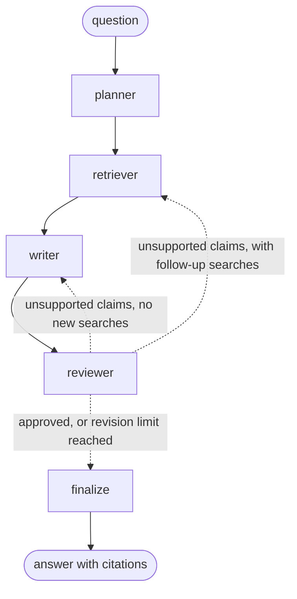

# docqa-agent

A read-only [MCP](https://modelcontextprotocol.io) server that lets any MCP client, such as Claude Code, Claude Desktop or your own agent, search the PDF documents indexed by [DocQA](https://github.com/JasrajCode/docqa).

It reads the same Postgres + pgvector tables that DocQA writes, so an AI assistant gets DocQA's semantic search as a set of tools it can call. The repo also includes `docqa-ask`, a LangGraph agent that answers questions through the server and has every claim checked against its sources.

```
Claude Code / Claude Desktop / your agent
            │  MCP over stdio
            ▼
       docqa-agent ───────► OpenAI (embeds the search query)
            │  read-only Postgres role
            ▼
  Neon Postgres + pgvector ◄── DocQA (writes chunks and embeddings)
```

## Tools

| Tool | What it does |
|---|---|
| `search_documents(query, k=5, document_id=None)` | Embeds the query and returns the `k` closest chunks by cosine similarity, best first |
| `get_chunk(chunk_id)` | Returns a single chunk, for example to quote it exactly |
| `list_documents()` | Lists the available documents with their status and chunk count |

All three are marked read-only, and results come back as structured JSON validated by pydantic models.

## Agent

`docqa-ask` answers a question with a LangGraph workflow that runs on top of the MCP server:



| Node | Role |
|---|---|
| `planner` | LLM. Splits the question into up to 4 search queries, or none if it can be searched as written |
| `retriever` | No LLM. Runs the queries through the server's `search_documents` tool in parallel and merges the passages |
| `writer` | LLM. Drafts an answer citing passages inline by `chunk_id`, and lists each claim with its sources |
| `reviewer` | Rejects citations of passages that were never retrieved without calling the LLM. Otherwise an LLM checks each claim against its passages, reasoning before each verdict, and can request follow-up searches. Approval is computed in code from the per-claim checks, so it can't contradict them |
| `finalize` | Resolves citations to document titles and records whether the reviewer approved |

The reviewer can send a draft back at most twice (`AGENT_MAX_REVISIONS`), so a run makes 3 to 7 LLM calls. When the limit is reached, the answer is returned with its unsupported claims listed.

```bash
uv run docqa-ask "Which datasets were used to evaluate RAG?"
uv run docqa-ask --json "Which datasets were used to evaluate RAG?"
```

All three LLM roles use one Claude model (`AGENT_MODEL`, Claude Haiku by default) with pydantic-validated structured outputs. The agent reaches the server through mcp's own client over a single stdio session per run. `langchain-mcp-adapters` was the original plan, but it requires mcp below 2.0 and this server is built on mcp 2.

To trace runs, set `LANGSMITH_TRACING=true` and `LANGSMITH_API_KEY` in `.env`. Each run then appears in LangSmith with every node's inputs, outputs, latency and token usage.

## Design decisions

**Direct database access with a read-only role.** The server connects to DocQA's database as `docqa_agent_ro`, which can only `SELECT` from `Document` and `Chunk` ([sql/readonly_role.sql](sql/readonly_role.sql)). `Account` holds users' OAuth tokens, so the role can't see it. A test runs that exact SQL and confirms the role can't read `Account`, delete rows or create tables.

**Scope comes from config, never from tool arguments.** The model chooses tool arguments, so a prompt-injected document could otherwise ask for another user's data. The users this server may read are fixed in `DOCQA_SCOPE_USER_IDS`, and every query filters on them. `get_chunk` returns the same "not found" for a missing chunk and for someone else's, so chunk ids can't be probed.

**Search matches DocQA.** Query embeddings use the same model, dimensions and newline handling as DocQA's `lib/embeddings.ts`, and ranking uses the same pgvector cosine distance. A parity test compares this server's results with DocQA's own retrieval (see below). One deliberate difference: only `READY` documents are searchable here, so a half-processed upload is never served.

**Neon details.** Neon's pooled endpoint runs PgBouncer in transaction mode, which breaks prepared statement caching, so asyncpg's statement cache is off. Neon's copied URLs also include `channel_binding`, which asyncpg would forward to Postgres as an unknown setting, so it is stripped.

## Setup

1. Install dependencies with [uv](https://docs.astral.sh/uv/):
   ```bash
   uv sync
   ```
2. Create the read-only role by running [sql/readonly_role.sql](sql/readonly_role.sql) in Neon's SQL editor, after replacing the password and database name.
3. Copy `.env.example` to `.env` and fill it in. Use Neon's pooled connection string with the `docqa_agent_ro` credentials, not DocQA's main ones. `ANTHROPIC_API_KEY` is only needed for `docqa-ask`.

## Connect it to Claude

Claude Code:

```bash
claude mcp add docqa -- uv --directory /path/to/docqa-agent run docqa-mcp
```

Claude Desktop (`claude_desktop_config.json`):

```json
{
  "mcpServers": {
    "docqa": {
      "command": "uv",
      "args": ["--directory", "/path/to/docqa-agent", "run", "docqa-mcp"]
    }
  }
}
```

Then ask something like "What datasets does the RAG paper use? Cite the chunks."

## Development

```bash
uv run pytest            # needs Docker: tests start a throwaway pgvector container
uv run ruff check .
uv run ruff format .
uv run pyright
```

| Test file | Covers |
|---|---|
| `test_repository.py` | Ranking, scoping, READY filtering, single-document search, chunk lookup |
| `test_server.py` | Tool schemas, read-only annotations, and results and errors over MCP, validated against each tool's output schema the way strict clients like Claude Code do |
| `test_stdio.py` | Launches the real entry point as a subprocess, the same way Claude Code does |
| `test_readonly_role.py` | The role SQL grants exactly the access it claims to |
| `test_embeddings.py` | Same model, dimensions and preprocessing as DocQA |
| `test_config_and_db.py` | Config parsing, secret masking, Neon URL handling |
| `test_parity.py` | This server's search vs DocQA's retrieval on real data (skipped without credentials) |
| `test_agent_graph.py` | Agent routing with scripted LLM responses: planning, follow-up searches, rewrites, the revision limit, fabricated citations |
| `test_reasoner.py` | The reviewer's verdict is derived from its per-claim checks |
| `test_agent_mcp.py` | The agent's MCP client against the real server, including a full agent run |
| `test_agent_live.py` | One full run with real Claude calls (skipped without `ANTHROPIC_API_KEY`) |

CI runs lint, format check, type check and tests on every push and pull request.

## Parity test

The parity test checks that this server returns the same chunks and scores as DocQA for a few real queries against the demo document.

1. Capture DocQA's results, from the `docqa` repo:
   ```bash
   npx tsx scripts/capture-retrieval.ts ../docqa-agent/tests/fixtures/parity.json
   ```
2. Run it here, with real credentials in `.env`:
   ```bash
   uv run pytest -m integration
   ```

If the demo document is ever re-processed, its chunk ids change, so capture the fixture again.
